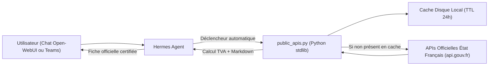

# 🏛️ Public-APIs — Passerelle Souveraine Open Data & Entreprises

Ce dossier abrite la compétence native **Public-APIs**, la passerelle d'accès sécurisée, gratuite et souveraine aux référentiels de données ouvertes de l'État français et d'Europe.

---

## 🎯 Le Pourquoi (The Why)

### 1. Le problème des données externes et des hallucinations des LLM
- **Données d'entreprises obsolètes ou inventées** : Les modèles de langage (LLM) ne possèdent pas la base Sirene en temps réel. Lorsqu'on leur demande le SIRET, les dirigeants ou le statut d'une entreprise, ils ont une forte tendance à halluciner des numéros légaux ou des informations juridiques fausses.
- **Le risque du surf Internet libre en entreprise** : Permettre à un agent autonome d'exécuter des requêtes HTTP arbitraires vers Internet pose deux risques majeurs :
  1. *Fuite de données* : Envoi involontaire de données à caractère personnel (PII) ou de secrets internes dans les paramètres d'URL.
  2. *Violation de l'étanchéité réseau* : Rupture de la politique d'hermétisme du cluster Kubernetes souverain.

### 2. La solution ArcIA : Open Data certifié, gratuit et borné
Public-APIs fournit un pont direct et contrôlé vers les APIs officielles de l'État français :
- **100% Gratuit (0 €)** : Basé sur l'Open Data souverain (licence ouverte Etalab). Aucune carte bancaire, aucun abonnement, aucune clé secrète à renouveler.
- **Données certifiées conformes** : Rapprochement en direct avec les registres de l'INSEE, du Répertoire National des Entreprises (RNE) et de la Base Adresse Nationale (BAN).
- **Protection DLP & Cache local** : Réponses mises en cache sur disque pendant 24h (< 50 ms pour les requêtes répétées) et flux sortants assainis par Presidio DLP.

---

## ⚙️ Le Comment (The How)

### 1. Architecture du Système
Public-APIs repose sur une architecture modulaire à 3 composants :



1. **Le Catalogue Homologué ([`catalog.json`](catalog.json))** : Référentiel JSON des APIs ouvertes autorisées (Entreprises, Adresses, Météo-France, Cadastre IGN).
2. **Le Moteur d'Interrogation ([`scripts/public_apis.py`](scripts/public_apis.py))** : Script autonome (Python standard library, zéro dépendance pip) gérant les appels HTTP avec timeout, la mise en cache sur disque et le calcul mathématique de la clé de TVA intracommunautaire.
3. **La Fiche d'Instructions ([`SKILL.md`](SKILL.md))** : Formalise les règles de déclenchement pour l'agent (reconnaissance automatique des requêtes SIRET/SIREN, adresses ou météo).

---

## 🚀 Utilisation & Exemples Concrets

### 1. Recherche & Vérification d'Entreprise
Recherche par nom d'entreprise, numéro SIREN (9 chiffres) ou numéro SIRET (14 chiffres) :
```bash
python skills/public-apis/scripts/public_apis.py company "130025265"
```
*Résultat produit :*
- Nom complet et raison sociale officielle
- SIREN et SIRET de l'établissement siège
- **Numéro de TVA Intracommunautaire calculé automatiquement** (`FR...`)
- État administratif : 🟢 Actif (en activité) ou 🔴 Radié / Fermé
- Code NAF / APE et libellé d'activité
- Date de création officielle
- Adresse postale complète du siège
- Noms et qualités des dirigeants principaux

### 2. Validation & Géocodage d'Adresse (Base Adresse Nationale)
Normalise une adresse postale et en extrait les coordonnées GPS précises :
```bash
python skills/public-apis/scripts/public_apis.py address "20 avenue de segur paris"
```

### 3. Météo Ouverte
Récupère les conditions courantes et prévisions à partir d'une commune ou de coordonnées GPS :
```bash
python skills/public-apis/scripts/public_apis.py meteo "Paris"
```

### 4. Consultation du Catalogue
Affiche la liste complète des APIs publiques intégrées et leurs caractéristiques :
```bash
python skills/public-apis/scripts/public_apis.py catalog
```

---

## 🔒 Sécurité & Intégration Kubernetes

- **Déploiement K8s** : Le script et le catalogue sont automatiquement injectés par [`scripts/deploy.py`](../../scripts/deploy.py) dans le ConfigMap `arcia-native-skills` et montés sous `/opt/shared-skills/arcia/public-apis/` dans le pod Hermes Agent ([`deploy/manifests/06-hermes-agent.yaml`](../../deploy/manifests/06-hermes-agent.yaml)).
- **Filtrage Presidio DLP** : Aucun secret interne ni PII sensible n'est envoyé vers l'extérieur.
- **Conformité NetworkPolicy** : Les flux sortants sont restreints aux seuls domaines officiels homologués (`*.api.gouv.fr`, `api.open-meteo.com`, `apicarto.ign.fr`).

---

## 📖 Fichiers Associés
- [`SKILL.md`](SKILL.md) : Fiche de directives opérationnelles pour Hermes Agent.
- [`catalog.json`](catalog.json) : Annuaire structuré des APIs publiques souveraines.
- [`scripts/public_apis.py`](scripts/public_apis.py) : Moteur d'exécution déterministe avec cache 24h.
- [`tests/test_public_apis.py`](../../tests/test_public_apis.py) : Suite de tests unitaires automatisés.
