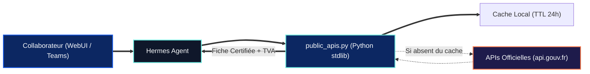

  
  
  

# 🏛️ Public-APIs — Passerelle Souveraine Open Data & Entreprises

> **[🏠 Accueil ArcIA](../../README.md)** › **[🧠 Compétences](../README.md)** › **Public-APIs (`skills/public-apis/`)**

Ce dossier abrite la compétence native **Public-APIs**, la passerelle d'accès gratuite, sans clé API et souveraine aux référentiels officiels de données ouvertes (INSEE SIRENE / RNE, Base Adresse Nationale, Météo).

---

## 🎯 Pourquoi Public-APIs ?

* **Zéro hallucination sur les données légales** : Vérification en temps réel des numéros SIREN/SIRET, de la raison sociale, de l'état administratif, des dirigeants et calcul mathématique de la clé de TVA intracommunautaire (`FR...`).
* **Étanchéité réseau maîtrisée** : Au lieu d'autoriser une navigation web arbitraire, seuls les endpoints Open Data homologués dans [`catalog.json`](catalog.json) sont interrogés, avec un cache disque local de 24h (`< 50 ms`).
* **100 % bibliothèque standard Python** : Aucun package tiers requis, zéro abonnement payant.

---

## 🚀 Commandes & Exemples d'Utilisation

| Commande | Exemple d'Exécution | Résultat |
|---|---|---|
| **Recherche d'entreprise** | `python skills/public-apis/scripts/public_apis.py company "130025265"` | Raison sociale, SIREN/SIRET, TVA intracommunautaire calculée, code NAF, statut actif/radié, siège et dirigeants. |
| **Géocodage d'adresse (BAN)** | `python skills/public-apis/scripts/public_apis.py address "20 avenue de segur paris"` | Adresse postale normalisée, code INSEE et coordonnées GPS. |
| **Météo ouverte** | `python skills/public-apis/scripts/public_apis.py meteo "Paris"` | Conditions courantes et prévisions par commune ou GPS. |
| **Catalogue homologué** | `python skills/public-apis/scripts/public_apis.py catalog` | Liste complète des APIs publiques autorisées. |

---

## 📖 Fichiers Associés
* 📄 **[SKILL.md](SKILL.md)** : Directives opérationnelles pour Hermes Agent.
* 🗂️ **[catalog.json](catalog.json)** : Annuaire structuré des APIs publiques souveraines.
* 🐍 **[scripts/public_apis.py](scripts/public_apis.py)** : Moteur d'exécution avec cache 24h ([documentation scripts](scripts/README.md)).
* 🧪 **[tests/test_public_apis.py](../../tests/test_public_apis.py)** : Suite de tests unitaires automatisés.
